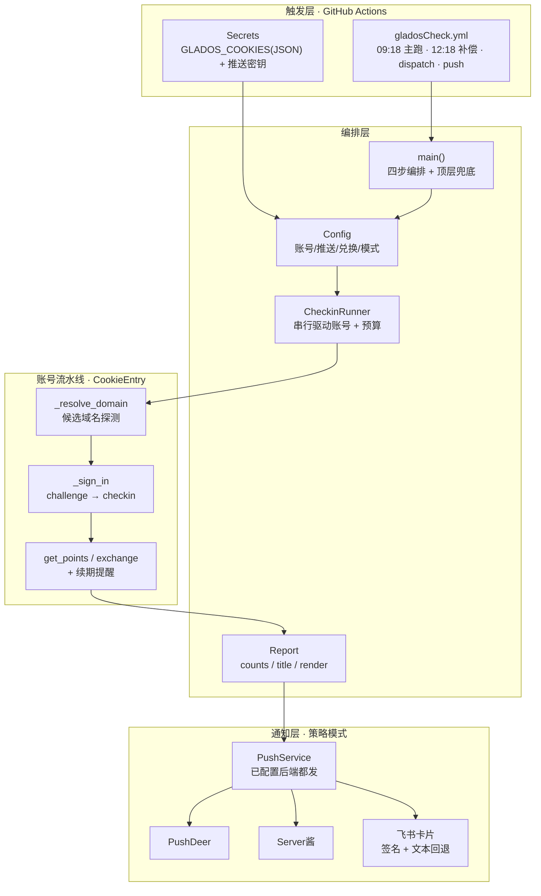
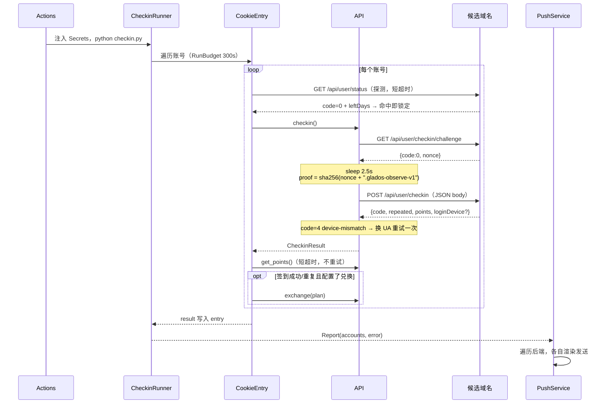

# CODEMAP · 功能代码地图

> 更新于 2026-11-14，基于 `checkin.py`（同步上游 `4d3e1e5` + 飞书/补偿跑移植）。
> 覆盖范围：`glados-auto-checkin`（运行仓库）+ `glados-setup`（本机调试工具集）。
> 本文件为文档，不参与构建与运行；**不含任何真实 Cookie / Webhook / SendKey**。

---

## 1. 项目定位

一句话：**跑在 GitHub Actions 上的 GLaDOS 账号每日自动签到机器人**——探测账号所属域名、完成 challenge 校验签到、查询积分与剩余天数，并把结果推送到手机。

| 项 | 值 |
|---|---|
| 运行平台 | GitHub Actions（`ubuntu-latest`，Python 3.13） |
| 上游仓库 | `Devilstore/Glados-Railgun-checkin`（fork） |
| 本仓库 | `chengzi2333/Glados-Railgun-checkin` |
| 许可证 | MIT（上游 2026-11 由 GPL-3.0 切换） |
| 目标站点 | 8 个候选域名，命中登录态即锁定：`glados.cloud` / `railgun.info` / `glados.network` / `glados.rocks` / `glados.one` / `glados.space` / `glados.vip` / `glados-facility.com` |
| 输入 | GitHub Repository Secrets（环境变量注入） |
| 输出 | Actions 日志 + PushDeer / Server酱 / 飞书群机器人 |
| 主入口 | `checkin.py::main()`（`checkin.py:1521`） |

`glados-setup` **不是产品代码**：开发期本机调试脚本集（Chrome CDP 抓 Cookie、接口探测、本地假 webhook 断言），不在 git 版本控制内，也不被 workflow 引用。

---

## 2. 顶层架构



---

## 3. 文件清单与职责

| 路径 | 类型 | 职责 | 线上运行 |
|---|---|---|---|
| `.github/workflows/gladosCheck.yml` | 调度 | 两条独立 cron（09:18 / 12:18，`Asia/Shanghai`）、concurrency 去重、注入 Secrets、判定补偿跑、keepalive、清理旧 run | 是 |
| `checkin.py` | 主程序 | 全部业务逻辑（约 1560 行，单文件八段式） | 是 |
| `logging_config.py` | 日志 | 北京时间 converter、级别短标签、凭证脱敏 | 是 |
| `requirements.txt` | 依赖 | `requests>=2.31,<3` / `pypushdeer==0.0.3` / `serverchan-sdk>=1.0.6,<2` | 是 |
| `README.md` | 文档 | 上手、账号 JSON 格式、推送、排查、FAQ | 否 |
| `CODEMAP.md` | 文档 | 本文件 | 否 |
| `LICENSE` | 许可 | MIT | 否 |
| `glados-setup/*.mjs` | 工具 | CDP 抓 Cookie、探测接口（4 个脚本） | 否 |
| `glados-setup/test-*.py` | 工具 | 本地假 webhook 断言（4 个脚本，**基于旧版 API，需适配**） | 否 |

### `checkin.py` 八段结构

| 区段 | 行号 | 内容 |
|---|---|---|
| 常量与枚举 | 28-153 | `CheckinStatus` / `ExchangePlan` / `APIEndpoint` / `LogEmoji` / `ProbeResult` / `STATUS_META` / `PLATFORM_UA` / `CANDIDATE_DOMAINS` / `EXCHANGE_PLANS` |
| 纯工具函数 | 155-261 | `to_int` `left_days` `normalize_origin` `format_days` `format_points` `log_line` `safe_call` `RunBudget` |
| 数据模型 | 267-635 | `CheckinResult` / `CookieEntry`（探测+签到）/ `Accounts`（JSON 解析+去重） |
| 响应解析 | 640-733 | `earned_points` / `log_reject` / `parse_checkin`（含 `repeated` 判定） |
| API | 736-1010 | 单站点会话：`checkin` / `fetch_status` / `get_points` / `exchange` / `_checkin_challenge` / `request(json_body)` |
| 配置 | 1013-1136 | `Config`（账号 / 推送 / 兑换 / verbose / mode） |
| 报告与推送 | 1139-1478 | `Report` / `PushBackend` / `PushDeer` / `ServerChan` / **`Feishu`** / `PushService` |
| 编排与入口 | 1480-1560 | `CheckinRunner` / `should_push` / `main` |

---

## 4. 运行时数据流



### 关键分支

| 场景 | 行为 | 代码 |
|---|---|---|
| 域名探测 | 按候选顺序 GET `/status`，`code=0` 且有 `data` 即命中；网络无响应的域名再用长超时重试一次 | `_resolve_domain:449` |
| 全部无权限 | 明确日志「Cookie 失效 / 账号不在候选域名内」 | `_report_failure:497` |
| 设备不匹配 | 未配置 `user-agent` 时按服务端 `loginDevice` 自动切 UA 重试一次；配置了则原样使用并给出建议 | `API.checkin:810` |
| challenge | 拿到 nonce 后**固定等待 2.5s**，proof 用 JSON body 提交；challenge 获取失败才回退旧协议（form、无 proof） | `_checkin_challenge:953` / `_checkin_attempt:978` |
| 重复签到 | `repeated=true` 或 `code=1` → REPEAT，不算失败 | `parse_checkin:677` |
| 兑换 | 仅签到成功/重复时执行，且禁用了 HTTP 重试（避免重复扣分） | `_apply_exchange:383` |
| 预算耗尽 | 300s 后跳过剩余账号，避免 Actions 长时间挂起 | `RunBudget:251` |
| 补偿跑 | `CHECKIN_MODE=backup` 且无成功账号 → 不推送 | `should_push:1514` |

---

## 5. 核心模型

| 名称 | 位置 | 内容 |
|---|---|---|
| `CheckinStatus` | 28 | `SUCCESS=0` / `REPEAT=1` / `FAILURE=-2` |
| `ProbeResult` | 72 | `HIT` / `NETWORK` / `REJECTED` |
| `CheckinResult` | 267 | `domain / points(int) / days / points_total / exchange / note / code` |
| `CookieEntry` | 284 | 一个账号的完整流水线；`label` 形如 `1:主号` 或 `账号1` |
| `Accounts` | 524 | JSON 数组解析、字段校验、重复 Cookie 去重 |
| `Report` | 1139 | `counts{success,fail,repeat}` / `title` / `render(line_sep)` / `error` |
| `RunBudget` | 251 | 单轮 300s 预算 |

`Report.render()` 的 `line_sep` 由后端决定：PushDeer `\n`、Server酱 `"  \n"`（Markdown 硬换行）、飞书文本回退 `\n`。

---

## 6. 配置矩阵

### `GLADOS_COOKIES`（JSON 数组，必填）

```json
[
  {
    "name": "主号",
    "origin": "glados.cloud",
    "cookie": "koa:sess=...; koa:sess.sig=...; gld:sess=...",
    "user-agent": "Mozilla/5.0 (Macintosh; Intel Mac OS X 10_15_7) ... Safari/537.36"
  }
]
```

| 字段 | 必填 | 说明 |
|---|---|---|
| `cookie` | 是 | 完整 Cookie，需含 `koa:sess` 或 `gld:sess` |
| `name` | 否 | 备注名，不填显示 `账号N` |
| `origin` | 否 | Cookie 所属域名，不填则按候选列表探测 |
| `user-agent` | 否 | 提取 Cookie 时的浏览器 UA；**填了可彻底避免设备不匹配** |

字段名固定，出现未知字段直接报错；旧 `&` 分隔仍兼容但会提示迁移。

### Secrets 一览

| 变量 | 必填 | 默认 | 消费位置 | 说明 |
|---|---|---|---|---|
| `GLADOS_COOKIES` | **是** | 空 → 退出码 1 | `Config:1097` | JSON 数组 |
| `GLADOS_EXCHANGE_PLAN` | 否 | `none` | `Config:1111` | `plan100/200/500`，非法值降级为跳过 |
| `PUSHDEER_SENDKEY` | 否 | 空 | `Config:1076` | 配置即启用 |
| `SERVERCHAN_SENDKEY` | 否 | 空 | `Config:1076` | 配置即启用，延迟导入 SDK |
| `FEISHU_WEBHOOK` | 否 | 空 | `Config:1076` | 飞书群机器人地址 |
| `FEISHU_SECRET` | 否 | 空 | `Config:1076` | 启用签名校验时填 |
| `GLADOS_VERBOSE` | 否 | `false` | `Config:1122` | 详细响应日志（workflow 未注入，本地用） |
| `CHECKIN_MODE` | 否 | `normal` | `Config:1087` | `backup` = 补偿跑静默，由 workflow 注入 |

### 调度

| cron（`Asia/Shanghai`） | 模式 | 行为 |
|---|---|---|
| `18 9 * * *` | `normal` | 主跑，无论结果都推送 |
| `18 12 * * *` | `backup` | 仅本次有签到成功才推送 |

两条 cron **必须分开写**，否则 `github.event.schedule` 无法区分主跑与补偿跑。另有 `workflow_dispatch`（可选 normal/backup）与 `push`（忽略文档与图片）。

---

## 7. 推送后端

| 后端 | 类 / 行号 | 渲染 | 签名 | 失败处理 |
|---|---|---|---|---|
| PushDeer | `1204` | 纯文本 `\n` | — | 捕获异常记 error |
| Server酱 | `1229` | Markdown 硬换行 `"  \n"` | — | 未装 SDK 不阻断其他后端 |
| 飞书 | `1259` | 交互式卡片：配色 + 三指标 + `@所有人` + 控制台按钮 + 续期提醒 | HMAC-SHA256，`key = timestamp + "\n" + secret`，`msg=""` → base64 | 卡片被拒回退纯文本 |

`PushService.send()`（`1459`）向所有已配置后端发送，任一成功即返回 True；无后端则跳过。

飞书配色（`_status_style:1283`）：全失败 red / 部分失败 orange / 有成功 green / 仅重复 blue / 无结果 grey；脚本级异常（无账号）单独标 red「脚本执行出错」。

---

## 8. `glados-setup` 工具地图

`.mjs` 依赖本机 Chrome 以 `--remote-debugging-port=9222` 启动并已登录；用 Node 原生 `fetch` + `WebSocket` 走 CDP，无需 npm 依赖。

| 脚本 | 用途 | 输出 |
|---|---|---|
| `capture-cookies.mjs` | `Network.getAllCookies` 导出登录态，校验含 `gld:sess`/`koa:sess` | `glados-cookies.txt`（0600） |
| `check-account.mjs` | 页面内 `fetch('/api/user/status')`，邮箱脱敏 | 账号关键字段 |
| `probe-api.mjs` | 只读探测任意 API 路径 | `{status, body}` |
| `probe-checkin-shape.mjs` | POST 一次签到，观察响应结构 | 原始 JSON |
| `test-feishu*.py` | 假 webhook 断言卡片/签名/@提醒/静默 | 断言结果 |

> **注意**：4 个 `test-*.py` 写于旧版 API（`should_push(config, payload)`、`_build_card(title, payload)`），同步上游后**已不兼容**，需按 `Report` 模型改写后才能运行。`.mjs` 探测脚本不受影响。另：`probe-checkin-shape.mjs` 用 JSON body 探测，与新版提交方式一致。

---

## 9. 已知差异与待办

| # | 级别 | 内容 | 建议 |
|---|---|---|---|
| 1 | 工具失效 | `glados-setup/test-*.py` 基于旧版 payload API | 改写为 `Report` 模型，或迁入仓库 `tests/` 纳入 CI |
| 2 | 观测 | GitHub 免费调度有延迟（历史 run 实际在 15:00-18:00 才执行） | 属平台行为；已用 `timezone` 保证「北京时间」语义正确 |
| 3 | 工程化 | `glados-setup` 未纳入版本控制，脚本硬编码本机路径 | 迁入仓库或改为环境变量 |
| 4 | 可选 | `GLADOS_VERBOSE` 未在 workflow 注入，线上无法开启 | 如需线上排查，加一行 env 映射 |

已随上游修复、无需再管：`get_points` 兜底元组长度不一致、兑换阈值未生效、`urllib3` 未声明、单域名写死。

---

## 10. 维护速查

| 场景 | 改动点 |
|---|---|
| Cookie 失效（`候选域名均返回「没有权限」`） | 重抓 Cookie → 更新 `GLADOS_COOKIES`（建议顺带填 `user-agent`） |
| 设备不匹配反复出现 | 在账号 JSON 里补 `user-agent`（提取 Cookie 的浏览器 UA） |
| 服务端再改 challenge | `CHALLENGE_SUFFIX` / `CHALLENGE_DELAY_SECONDS` / `_checkin_attempt` 的 `json_body` |
| 新增设备平台 | `PLATFORM_UA`（键需与服务端 `loginDevice` 一致，已有 `Windows/macOS/Linux/iPhone/iOS/Android`） |
| 新增候选域名 | `CANDIDATE_DOMAINS`（顺序即探测顺序） |
| 新增推送渠道 | 继承 `PushBackend` 实现 `send(report)`，在 `PushService.__init__` 注册 |
| 调整推送时段 | workflow 两条 cron + `CHECKIN_MODE` 判定 + `FeishuBackend.SCHEDULE_HINT` |
| 排查线上问题 | Actions 日志（`🍪[账号] 🌐[域名]` 前缀）；本地 `GLADOS_VERBOSE=true` 复现 |

> 安全提示：Cookie、SendKey、Webhook、飞书签名密钥均为敏感值，只放 GitHub Secrets / 本机 0600 文件；日志会自动把 `koa:*` / `gld:*` / Bearer 脱敏为 `[REDACTED]`。
